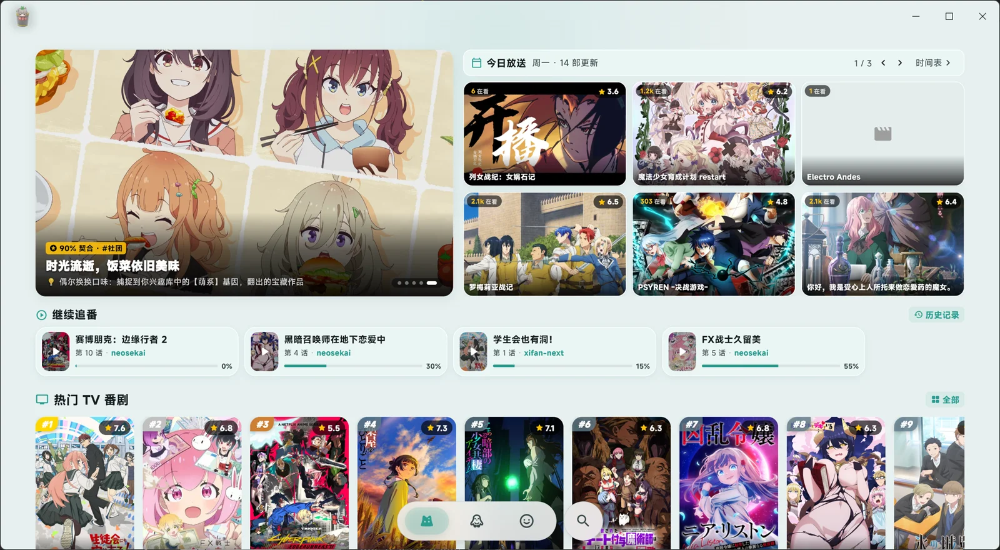
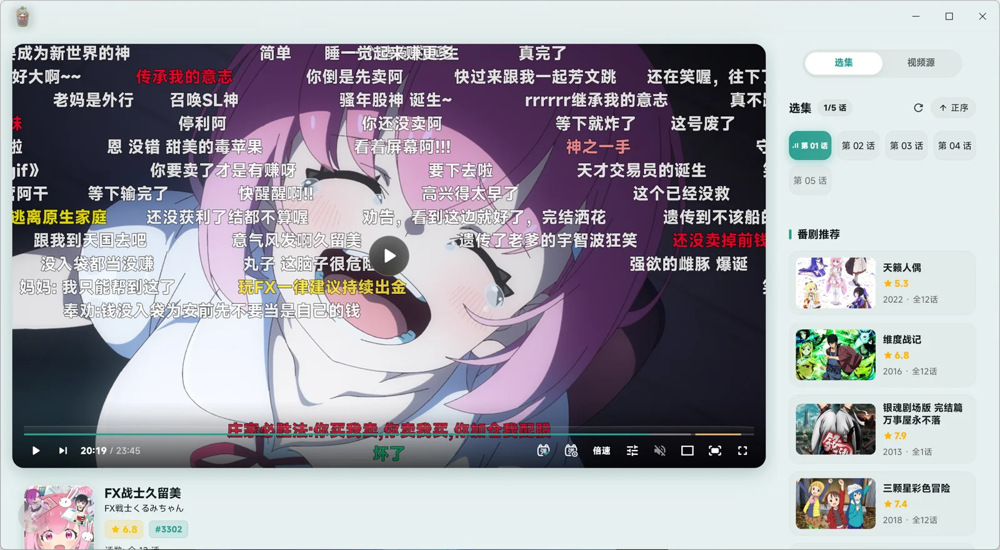
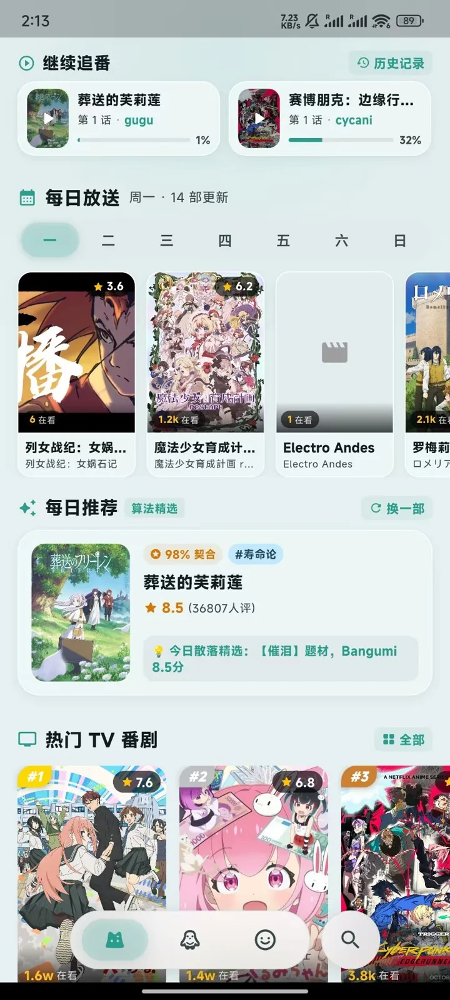
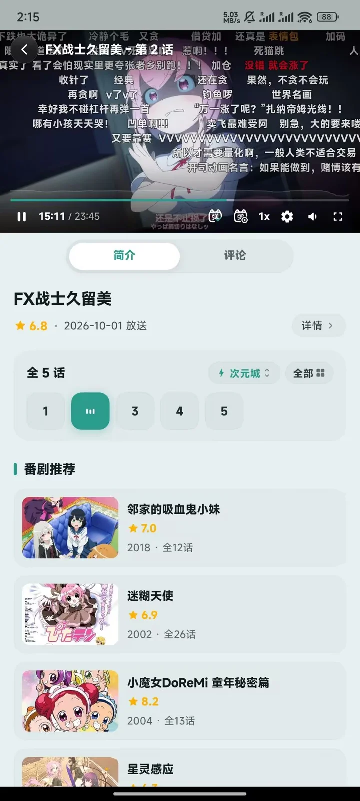

<div align="center">


<h1>Zakoway</h1>

<p><b>基于 Material 3 Expressive 设计规范与 Flutter 打造的现代化跨平台追番与在线播放客户端</b></p>

<p>
  <a href="https://github.com/uerax/zakoway/releases"></a>
  
  
  
  <a href="LICENSE"></a>
</p>

<p>深度打通 Bangumi 官方数据生态与弹幕交互平台，搭载 Anime4K 实时着色器超分辨率引擎与高性能硬件加速播放核心。<br>优雅沉浸、自由可塑，为动漫爱好者呈现极致视听体验 ヾ(≧▽≦*)o</p>

<p>
  <a href="#-支持平台">支持平台</a> •
  <a href="#-界面预览">界面预览</a> •
  <a href="#-核心特性">核心特性</a> •
  <a href="#-功能清单">功能清单</a> •
  <a href="#-下载安装">下载安装</a> •
  <a href="#-从源码构建">从源码构建</a> •
  <a href="#-常见问题-qa">常见问题</a> •
  <a href="#-致谢">致谢</a>
</p>

</div>

---

## 📱 支持平台

| 平台 | 最低版本要求 | 运行架构 | 构建状态 | 自动更新 |
| :--- | :--- | :--- | :--- | :--- |
| **Windows** | Windows 10 及以上 (64-bit) | x86_64 | 官方正式支持 (CI/CD 自动构建) |  支持 (内置静默检测与增量包拉取) |
| **Android** | Android 10.0 (API 29) 及以上 | arm64-v8a / armeabi-v7a / x86_64 | 官方正式支持 (通用包与分架构包) |  支持 (应用内直接下载与调起安装) |
| **macOS** | macOS 11.0 Big Sur 及以上 | Apple Silicon / Intel | 源码兼容支持 | 待规划 |
| **Linux** | 主流现代发行版 | x86_64 | 源码兼容支持 | 待规划 |
| **iOS** | iOS 14.0 及以上 | arm64 | 适配中 (需证书自签或侧载) | - |

---

## 📸 界面预览

### 🖥️ 桌面端体验 (Windows)

<table align="center" width="100%">
  <tr>
    <td width="50%" align="center">
      <br>
      <b>首页 · 今日推荐、周历货架与“继续追番”模块</b>
    </td>
    <td width="50%" align="center">
      <br>
      <b>播放器 · 沉浸式弹幕聚合、选集与快捷键控制</b>
    </td>
  </tr>
</table>

### 📱 移动端体验 (Android)

<table align="center">
  <tr>
    <td width="50%" align="center">
      <br>
      <b>首页 · 响应式流线布局与磨砂胶囊底部导航</b>
    </td>
    <td width="50%" align="center">
      <br>
      <b>播放页 · 置顶硬解播放、分集与视频源快速切换</b>
    </td>
  </tr>
</table>

---

## ✨ 核心特性

### 🎨 Material 3 Expressive 现代美学与壁纸融合
- **自适应表面融合引擎 (`M3Surface`)**：突破传统固定色彩限制，支持上传自定义壁纸。系统智能提取背景基色并实时重构多级色调表面（Surface Containers），让界面组件如磨砂玻璃般通透且柔和地融于背景之中。
- **丰富的预设主题体系**：内置薄荷绿、极光青、樱花粉、深海蓝等 9 款 M3 预设调色板，并支持无限自定取色与智能深色/浅色模式平滑切换。
- **全屏响应式布局**：无论是宽屏桌面端的双列分栏 Hero 展示，还是移动端灵动悬浮的磨砂胶囊底部导航栏，均可自适应拉伸与断点重排，操作逻辑自然贴合各端交互习惯。
- **字型降级安全保障**：全平台内嵌优质现代化无衬线字体，并在底层彻底拦截 Windows DirectWrite 意外跌落至宋体的问题。

### 🚀 Anime4K GPU 实时超分辨率着色器管线
- 内置针对动漫线条与纹理专门训练的 **Anime4K GLSL 着色器矩阵**。
- 支持从效率档（S 档）到旗舰还原档（VL 档）自由调节，包括 `Upscale CNN` 线条重构、`Restore CNN` 噪点伪影修复及 `Clamp Highlights` 降高光处理。低分辨率经典老番在 2K/4K 屏幕上瞬间焕发高清新生。

### 🎬 跨平台高性能播放核心
- 依托跨平台多媒体框架底座，支持主流视频格式（H.264/AVC、HEVC/H.265、AV1、VP9 等）全硬件加速硬解。
- 毫秒级音画同步控制，智能 HLS 媒体流自适应解析与音画分离流自动对齐。
- **桌面端极致交互**：支持独立浮动操作面板、滚轮音量与进度快速掠过、全键盘快捷键覆盖、防误触全屏沉浸模式。
- **移动端手势优化**：左侧滑动亮度微调、右侧滑动音量调节、双击快进快退及长按倍速试听。

### 💬 弹幕聚合与双向时移校准
- **多源弹幕无缝整合**：集成 **弹弹play** 与 **Bilibili** 开放弹幕，支持跨平台弹幕池多路聚合并发拉取。
- **弹幕时移微调步进器**：支持亚秒级全局与分源弹幕时间轴前后偏移调节，告别视频源前贴广告或片头差异造成的弹幕错位。
- **多维度防剧透与过滤引擎**：内置文本标准化、正则过滤规则及 Bangumi 条目级安全防剧透屏蔽遮罩。

### 📚 Bangumi 开放生态原生互联
- **完整生态贯通**：深度适配 Bangumi OpenAPI，支持官方账号授权互联与个人收藏进度双向即时同步。
- **海量番剧检索与年谱分类**：涵盖每日放送日历、历史季度新番周历、多维标签索引以及高评分聚合排行榜。
- **断点无感续播**：自动精准记录每一集的播放进度与历史轨迹，首页“继续追番”模块让您一键接续上次观赏。

### 🌐 弹性路由与智能更新机制
- **动态网络路由分发**：支持动态载入与切换网络路由节点，应对不同网络环境下的访问阻滞。
- **自动化版本检测**：基于 jsDelivr CDN 分发网络加速拉取更新清单，支持应用内一键下载更新与静默升级。

---

## 📋 功能清单

- [x] Material 3 Expressive 设计规范与全平台响应式界面
- [x] 自定义背景壁纸与 `M3Surface` 自适应色阶提取融合
- [x] 9 款精选主题色预设与自定义十六进制色盘
- [x] Bangumi OpenAPI 原生对接（OAuth 登录、个人收藏、追番状态同步）
- [x] 每日放送周历与今日推荐精选货架
- [x] 分类多维年表（按年份、季度、题材类型多选标签聚合检索）
- [x] 番剧详情页（元数据、角色介绍、分集列表、条目评论防剧透显示）
- [x] 历史播放记录与秒级“继续追番”记忆
- [x] 跨平台硬件加速播放引擎 (基于 mpv 内核硬解加速)
- [x] 实时 Anime4K 超分辨率渲染管线（S/M/VL 档位切换与着色器组合）
- [x] 弹弹play + Bilibili 弹幕多路聚合与时移微调
- [x] 弹幕屏蔽过滤（正则匹配、类型过滤、密度控制与不透明度调整）
- [x] 视频播放器桌面端键鼠控制（滚轮无极调音、空格暂挂、方向键快进）
- [x] 视频播放器移动端手势交互（双击快进、侧边亮度音量划动）
- [x] 视频源多路嗅探与自适应流播放
- [x] 动态网络线路配置与反向代理切换
- [x] 应用全自动版本检测更新与 CDN 加速分发
- [ ] 离线视频分集下载与本地媒体管理
- [ ] 跨设备局域网同步播放 (SyncPlay 协议)
- [ ] 更多有趣的功能持续孵化中...

---

## 📥 下载安装

### 方式一：GitHub Releases (推荐)

前往项目发布页下载最新版本：

👉 **[前往下载 Zakoway 最新 Release](https://github.com/uerax/zakoway/releases/latest)**

- **Windows 用户**：下载 `Zakoway-v*-windows-x64.zip`，解压至任意目录后运行 `zakoway.exe` 即可使用。
- **Android 用户**：
  - 推荐下载 `zakoway-v*-android-universal.apk`（通用兼容包）；
  - 或根据设备 CPU 架构下载对应的精简包（如 `arm64-v8a`）。

---

## 🛠️ 从源码构建

若您希望在本地参与开发或自行编译项目，请确保已安装配置好以下环境：

### 前置环境要求
- **Flutter SDK**：`^3.13.4` 或最新稳定版 Stable Channel ([Flutter 官方安装指南](https://docs.flutter.dev/get-started/install))
- **Dart SDK**：随 Flutter SDK 一同分发
- **平台专属构建依赖**：
  - **Windows**：Visual Studio 2022（需勾选 "使用 C++ 的桌面开发" 工作负载）
  - **Android**：Android Studio / Android SDK (Platform API 34+ / Build-Tools) 与 JDK 17

### 编译步骤

1. **克隆仓库源码**
   ```bash
   git clone https://github.com/uerax/zakoway.git
   cd zakoway
   ```

2. **拉取依赖包**
   ```bash
   flutter pub get
   ```

3. **本地开发调试运行**
   ```bash
   # Windows 平台调试
   flutter run -d windows

   # Android 真机或模拟器调试
   flutter run -d android
   ```

4. **构建正式发布包**
   ```bash
   # 构建 Windows 绿色便携免安装版本 (生成于 build/windows/x64/runner/Release)
   flutter build windows --release

   # 构建 Android Release APK 安装包 (生成于 build/app/outputs/flutter-apk)
   flutter build apk --release
   ```

---

## ❓ 常见问题 (Q&A)

<details>
<summary><b>Q1: 为什么开启 Anime4K 超分辨率后播放偶尔会有卡顿或掉帧？</b></summary>
<br>
Anime4K 是一组基于 GPU GLSL 着色器的高密度实时计算算法，尤其是 <code>VL (Very Large)</code> 旗舰档位，对显卡的浮点算力有一定要求。
<br><br>
<b>建议排查与调整方案：</b>
<ul>
  <li>如果您的电脑使用的是集成显卡或能耗比受限的轻薄本，建议在播放设置中将超分档位切换至 <b>性能档 (S / M 档)</b>；</li>
  <li>对原生 1080P 或码率极高的片源使用超分会倍增显卡开销，建议优先在 720P 或低码率动漫片源上开启超分；</li>
  <li>在 Windows 显卡控制面板中确保 Zakoway 优先调用独立显卡（NVIDIA / AMD）运行。</li>
</ul>
</details>

<details>
<summary><b>Q2: 弹幕与视频画面不同步（早于或晚于画面出现）怎么办？</b></summary>
<br>
不同视频源由于片头版权声明、压制帧率或剪辑切片长度差异，可能会与公开弹幕池的时间戳产生轻微偏差。
<br><br>
您可以在播放器控制面板中点击 <b>弹幕设置</b> 图标，展开 <b>弹幕时移微调 (Danmaku Offset)</b>：
<ul>
  <li>点击 <code>+0.5s / +1.0s</code> 或 <code>-0.5s / -1.0s</code> 微调弹幕时间轴；</li>
  <li>系统会自动记忆该番剧当前集的时移偏移量，无需重复手动调整。</li>
</ul>
</details>

<details>
<summary><b>Q3: 番剧海报封面加载慢或 Bangumi 接口偶尔报错？</b></summary>
<br>
Bangumi 官方开放 API 服务器位于境外，部分网络环境下可能会产生 DNS 污染或握手延迟。
<br><br>
Zakoway 内置了智能内存与本地多级缓存机制：
<ul>
  <li>同一部番剧的元数据与图片在初次加载成功后会自动缓存于本地存储中；</li>
  <li>您可在设置选项卡中切换或自定义网络路由线路，利用社区反向代理加速数据直连。</li>
</ul>
</details>

<details>
<summary><b>Q4: 视频源解析失败或提示无法连接？</b></summary>
<br>
Zakoway 作为聚合客户端，不自建或存储任何音视频源流，播放源均通过社区开放规则与嗅探接口动态匹配。
<br><br>
如遇播放异常：
<ul>
  <li>可在播放界面展开视频源选择列表，切换到其他备用线路；</li>
  <li>若为偶发网络波动，点击播放器中央的重试按钮即可触发无缝重连。</li>
</ul>
</details>

<details>
<summary><b>Q5: Windows 平台下的字体显示效果如何保障？</b></summary>
<br>
针对 Windows 平台底层 DirectWrite 引擎在未指定字体时易降级为传统中易宋体 (SimSun) 的已知缺陷，Zakoway 全局内嵌了现代化无衬线字体，并为整个样式树显式注入了字体回退链，确保不论在哪个层级均能呈现平滑清晰的现代排版。
</details>

---

## 🤝 参与贡献

欢迎任何形式的贡献！无论是提交 Issue 报告 Bug、提出新功能建议，还是直接提交 Pull Request：

1. Fork 本仓库并新建分支：`git checkout -b feature/amazing-feature`
2. 提交您的修改：`git commit -m 'feat: add some amazing feature'`
3. 推送分支：`git push origin feature/amazing-feature`
4. 创建并提交一个 Pull Request。

---

## 📜 免责声明与隐私协议

1. **非盈利声明**：Zakoway 是一个基于 GPL-3.0 协议分发的开源、非盈利性学术与兴趣研究项目。
2. **内容归属**：本客户端不托管、上传、录制或存储任何番剧音视频文件与弹幕内容。所有番剧元数据来自 [Bangumi 番组计划](https://bangumi.tv/) 开放 API，弹幕内容来源于第三方开放平台。所有版权与商标均归其各自权利方所有。
3. **合法使用**：用户使用本客户端需自觉遵守所在地国家及地区的法律法规，请勿将本软件用于任何侵犯版权所有者权益或商业牟利的途径。
4. **隐私承诺**：Zakoway 尊重用户隐私，客户端不会收集、回传或分享任何用户个人数据，不集成任何第三方广告 SDK 或遥测跟踪组件。

---

## 🙏 致谢

衷心感谢以下优秀的开源项目与公共平台，正是它们奠定了 Zakoway 的坚实基石：

- **[Flutter](https://flutter.dev/) & [Dart](https://dart.dev/)**：跨平台 UI 开发框架。
- **[Bangumi 番组计划](https://bangumi.tv/)**：提供全面准确的动漫百科元数据与开放 API 生态支持。
- **[Anime4K](https://github.com/bloc97/Anime4K)**：为动漫量身定制的开源实时高质量超分辨率算法着色器。
- **[弹弹play](https://www.dandanplay.com/)**：提供开放的弹幕关联与检索服务。
- **[MiSans](https://hyperos.mi.com/font/zh/details/sc/)**：小米开源的现代无衬线设计字体。
- 以及所有为开源社区贡献力量的开发者们！ ❤️

---

<div align="center">
  <sub>Made with ❤️ by <a href="https://github.com/uerax">uerax</a> and contributors</sub>
</div>
